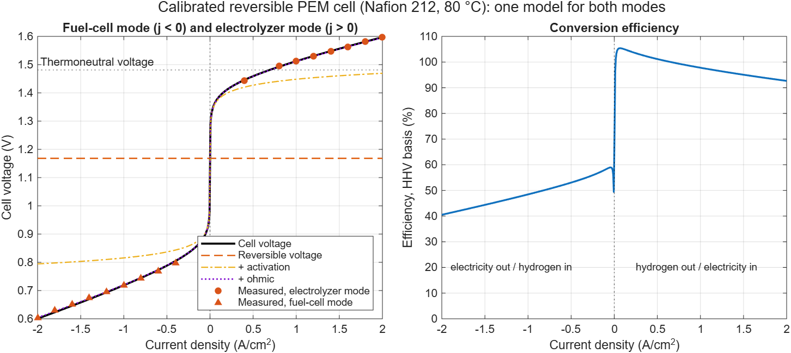
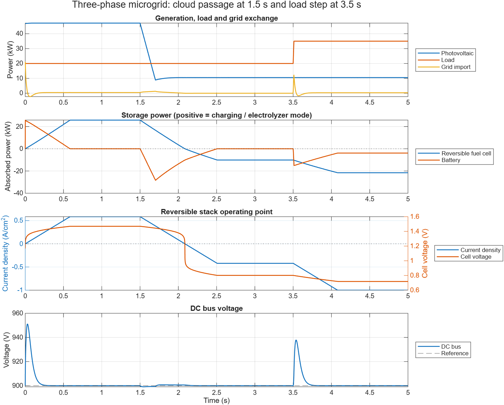
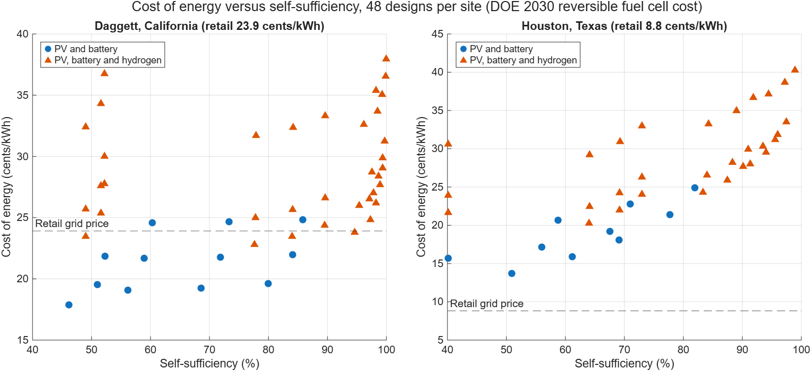
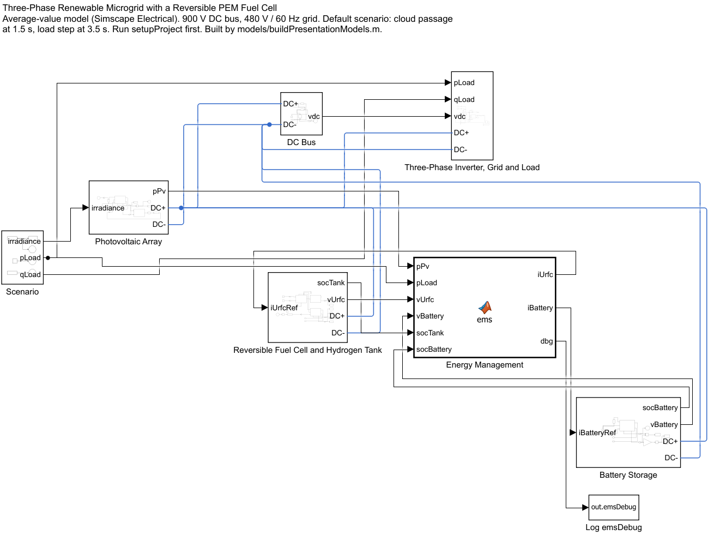

# Green Hydrogen Production: a Reversible PEM Fuel Cell in a Three-Phase Renewable Microgrid

Solution to [MathWorks Challenge Project 204, "Green Hydrogen Production"](https://github.com/mathworks/MATLAB-Simulink-Challenge-Project-Hub/tree/main/projects/Green%20Hydrogen%20Production), submitted to the MathWorks Global Student Challenge 2026.

**Author:** Amani Charles DETONGNON

## Problem statement

Green hydrogen is produced by water electrolysis powered by renewable electricity. The difficulty is to produce it economically and repeatably when the renewable source is variable and the same installation must also supply electricity.

The project asks for a reversible fuel cell model written in the Simscape language, able to work as an electrolyzer or as a generator, integrated in a three-phase renewable microgrid with solar power and energy storage. The models must then be used to compare operating profiles and system configurations, at several levels of fidelity, and to support data-driven recommendations for industry and government.

## Solution approach

One reversible PEM cell model is carried through three levels of fidelity that share the same equations and parameters.

| Level | Time scale | Model | Used for |
|---|---|---|---|
| Switching | microseconds to 0.5 s | two-level inverter with ideal switches and 10 kHz PWM | switching ripple, current distortion |
| Average-value | milliseconds to minutes | Simscape Electrical microgrid, average converters, discrete controllers | control, mode reversal, power sharing |
| Quasi-static | hours to one year | hourly power balance built on the same cell equations | energy, sizing, cost |

The main elements are:

1. **Reversible PEM cell** (`greenH2.ReversibleFuelCell`, Simscape language). A single set of equations covers both modes: positive current is electrolysis, negative current is power generation. The cell voltage is the reversible (Nernst) voltage plus activation, ohmic and concentration overpotentials that carry the sign of the current, so the voltage is continuous through zero current. Hydrogen crossover follows membrane permeation, and waste heat goes to a thermal port.
2. **Calibration on published data.** The cell parameters are fitted to polarization curves of a state-of-the-art unitized cell, digitized from a paper by image processing.
3. **Storage subsystem.** Stack, lumped thermal mass with PI temperature control, and a real-gas hydrogen tank (`greenH2.HydrogenTank`).
4. **Three-phase microgrid.** Photovoltaic array with MPPT, battery, reversible stack and tank on a 900 V DC bus, grid-following inverter on a 480 V / 60 Hz grid, rule-based energy management.
5. **Annual simulation and economics.** Hourly simulation with NASA POWER weather data for two sites in the United States, annualized cost with sourced cost data, sizing study, hydrogen production goals and sensitivity analysis.

A detailed description of the method, equations, validation and results is in [docs/report.md](docs/report.md).

## Key results



**Cell model**

- Fit to 24 digitized points in both modes (electrolyzer, fuel cell with oxygen, fuel cell with air): RMSE 5.3 mV, leave-one-out error 7.3 mV on interior points.
- Reversible voltage within 0.6 mV of theoretical potentials computed by NASA from thermodynamic tables (no fitted parameter).
- The ratio of fuel-cell voltage at 0.5 A/cm² to electrolyzer voltage at 1 A/cm² is 52.1 %; the DOE 2020 status for unitized cells is 52 % (not used in the fit).

**Storage subsystem (Simscape)**

- Round-trip efficiency on a higher-heating-value basis: 51.9 % for the stack, 47.4 % for the system including compression, heating and cooling.

**Three-phase microgrid**



- During a cloud passage the stack reverses from electrolyzer to fuel-cell mode through zero current while the battery covers the transient; the DC bus stays within 38 V of its 900 V reference and 98.7 % of the load is supplied without the grid.
- The average-value model reproduces the fundamental current of the switching model within 0.34 % and runs 13 times faster. The switching model shows a current distortion of 9.3 % with the present L filter, almost entirely at the switching frequency, which calls for an LCL filter.

**One-year operation and economics**



- Without hydrogen, self-sufficiency saturates near 86 % in California and 82 % in Texas over the designs studied; hydrogen storage is needed beyond that.
- In California (retail price 23.9 cents/kWh), 95 % self-sufficiency costs 1.04 times the retail price with the DOE 2030 reversible-fuel-cell cost and 1.35 times with the 2020 status. In Texas (8.8 cents/kWh) no design is competitive.
- Keeping the stack hot when idle costs 9.1 MWh per year of heating against 0.4 MWh when it is allowed to cool.
- Incremental cost of hydrogen for a production goal of 2 to 10 kg per day, at DOE 2030 costs: 2.7 to 6.6 $/kg in California, 11 to 14 $/kg in Texas.
- Sensitivity: the cost of energy is driven by the reversible-fuel-cell cost level (-7 % to +38 %), the discount rate (±14 %) and the photovoltaic cost (±11 %). Each uncalibrated physical estimate changes it by less than 0.4 %.

## How to run

Requirements: MATLAB R2026a with Simulink, Simscape, Simscape Electrical and Optimization Toolbox. Image Processing Toolbox is needed only to repeat the digitization of the published figure.

```matlab
main            % quick demonstration, about five minutes
main("full")    % adds the long studies, about fifteen more minutes the first time
runAllTests     % 58 automated tests, about seven minutes
```

`main` sets up the path, builds the custom Simscape library `greenH2_lib`, runs the demonstrations and saves the figures to `results/figures`. No code edit is required. The weather data and the digitized measurements are included in `data`.

The two saved models can be opened and run directly after `setupProject`; each contains a default scenario in its model workspace:

- `models/UrfcStorageSystem.slx`: reversible stack, thermal management and hydrogen tank
- `models/MicrogridAverage.slx`: three-phase microgrid, organized in subsystems (photovoltaic array, battery, reversible fuel cell and hydrogen tank, DC bus, three-phase inverter with grid and load, energy management)



These saved models are generated by `models/buildPresentationModels.m` from the flat models used in the analyses, by moving blocks into subsystems and rewiring every connection explicitly; a test checks that both give the same results.

## Repository structure

```
main.m, setupProject.m, runAllTests.m   entry points
simscape/+greenH2/    Simscape language components: ReversibleFuelCell, HydrogenTank,
                      DcDcCurrentControlled, DcDcVoltageControlled
src/+urfc/            cell model (MATLAB reference), parameters, calibration, storage cycle
src/+h2/              hydrogen equation of state and compression work
src/+microgrid/       controllers (inverter, MPPT, energy management), scenario simulation
src/+solar/           weather data reader, sun position, tilted-plane irradiance, PV power
src/+longterm/        hourly annual simulation
src/+econ/            cost data with sources, annualized cost
models/               scripts that build the Simulink models, and the saved models
analysis/             demonstrations and studies that produce the figures
validation/           calibration, digitization, comparison with MathWorks examples
                      and between fidelity levels
tests/                automated tests (matlab.unittest)
data/literature/      published reference values and digitized polarization data
data/weather/         NASA POWER hourly data, 2023, two sites
results/figures/      figures produced by the scripts
docs/                 technical report
```

## Verification and validation

- 58 automated tests: physical consistency of the cell model, agreement between the Simscape component and its MATLAB reference, mass and energy balances, controller logic, AC-side balance and frequency, solar geometry, economics, and equivalence of the saved models with the models used in the analyses.
- The Simscape component and the MATLAB reference implementation of the same equations agree within 1 microvolt.
- Cross-check between fidelity levels: one day of the annual model replayed in the Simscape storage model gives the same stack energies within 0.001 % and the same hydrogen consumption within 0.6 % (crossover during idle hours, neglected in the annual model).
- Comparison with the MathWorks PEM Fuel Cell and PEM Electrolysis examples.

What is not validated: there is no experimental validation on hardware. The cell is calibrated on one published cell at one temperature (80 °C) and ambient pressure. Thermal parameters, converter efficiencies and compressor efficiency are engineering estimates. Limitations are listed in the report.

## Use of MATLAB and Simulink

- **Simscape language** for four custom components, built into a library with `sscbuild`.
- **Simscape** (foundation electrical and thermal domains) for the storage subsystem.
- **Simscape Electrical** for the three-phase microgrid: average-value and switching converters, solar cell, battery, three-phase source and load.
- **Simulink** with MATLAB Function blocks for discrete controllers; the models are generated by scripts so that they are reproducible.
- **Optimization Toolbox** (`lsqnonlin`) for parameter identification.
- **Image Processing Toolbox** for the digitization of a published figure.
- **MATLAB unit testing framework** for verification.

## Use of generative AI

This project was developed with substantial assistance from a generative AI agent, Claude (Anthropic), used through Claude Code with the MATLAB MCP server, which lets the agent execute code in a live MATLAB session.

- The agent drafted the MATLAB and Simscape code, the model-building scripts, the tests and this documentation, under the direction of the author, who chose the project, the technology (reversible PEM), the country of study and the main orientations, and validated each stage.
- Every piece of AI-generated code was executed in MATLAB; nothing in this repository was left untested. The results reported here are the outputs of those executions.
- The agent was used to search and read technical sources. Values taken from the literature are quoted with their source in `data/literature/urfcLiteratureData.m` and `src/+econ/costData.m`. No data were generated by the AI: measurements come from the cited documents and weather data from NASA POWER.
- Assumptions that have no source are flagged as such in the code and in the report.
- The custom Simscape components and the reference cell model carry a note stating that they were drafted with AI assistance.

## References

Main sources; the complete list is in the report.

1. W. R. Bennett, P. J. Smith, I. J. Jakupca, *Analysis of 100-W Regenerative Fuel Cell Demonstration*, NASA/TM-20205000357, 2020.
2. D. Peterson, *Reversible Fuel Cell Targets*, DOE Hydrogen and Fuel Cells Program Record 20001, 2020.
3. X. Peng et al., *Hierarchical Electrode Design of Highly Efficient and Stable Unitized Regenerative Fuel Cells (URFCs) for Long-term Energy Storage*, Lawrence Berkeley National Laboratory, open-access manuscript.
4. NREL, *Annual Technology Baseline 2024*, Commercial PV and Commercial Battery Storage.
5. U.S. Energy Information Administration, *Annual Energy Outlook 2023*, cost and performance characteristics of new generating technologies; *Electric Power Annual*, Table 2.10.
6. NASA Langley Research Center, *POWER* project, hourly data.
7. MathWorks, *PEM Fuel Cell System* and *PEM Electrolysis System* examples (Simscape).
8. M. Barbosa, *Modeling and Simulation of a Green Hydrogen Energy Storage DC Microgrid*, earlier submission to this challenge project (reviewed, not reused).

## License

[MIT](LICENSE)
