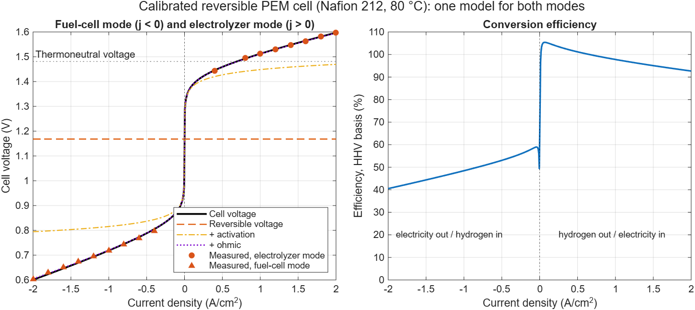
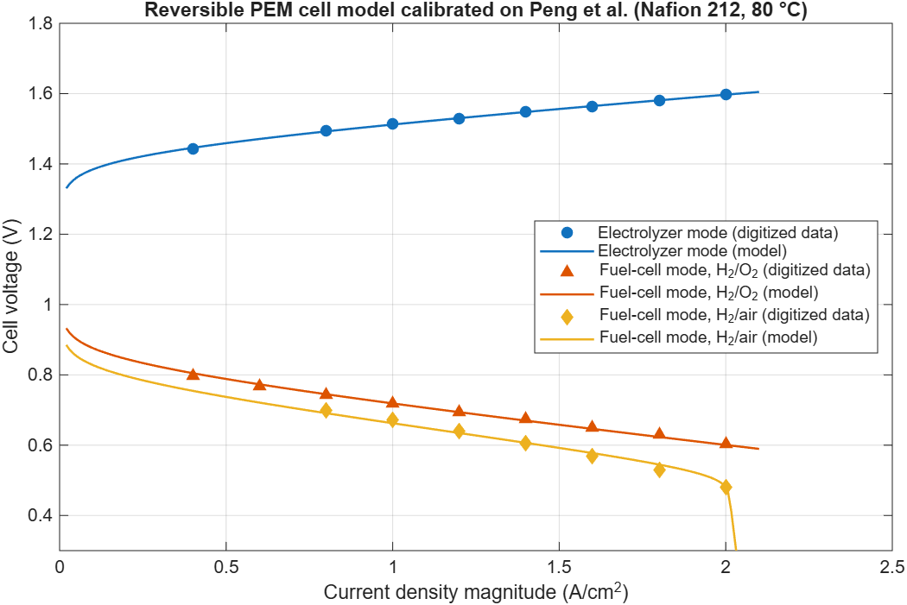
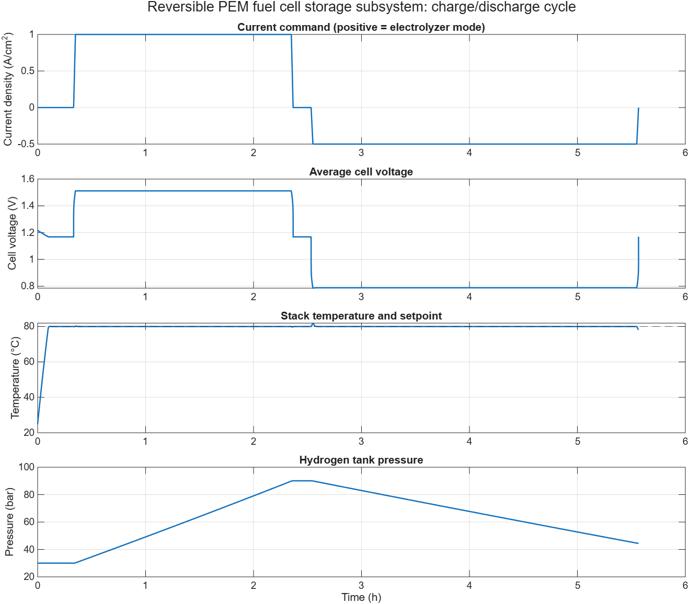
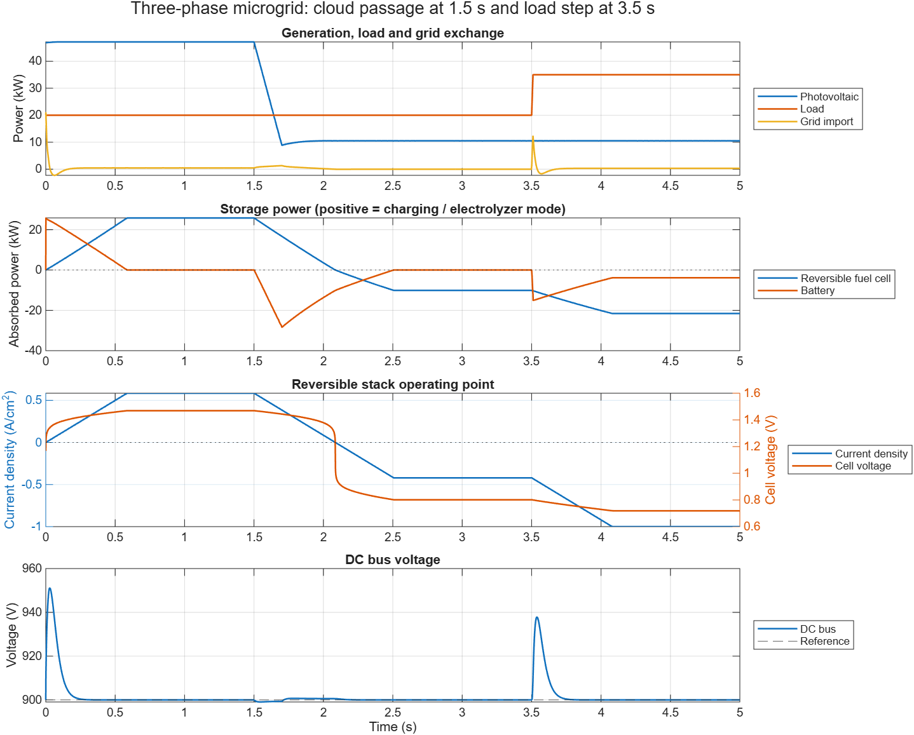
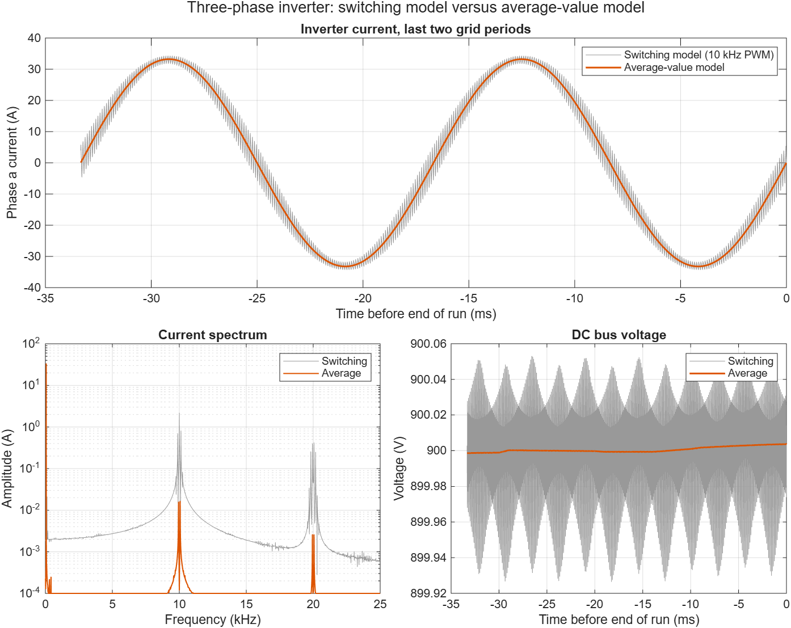
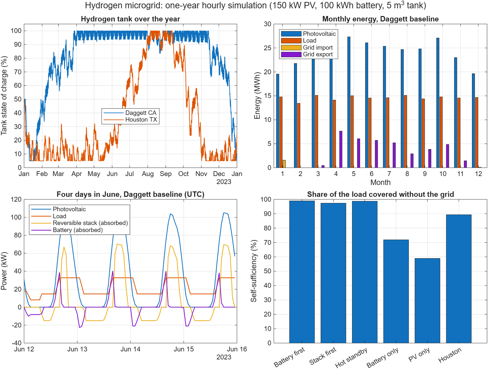
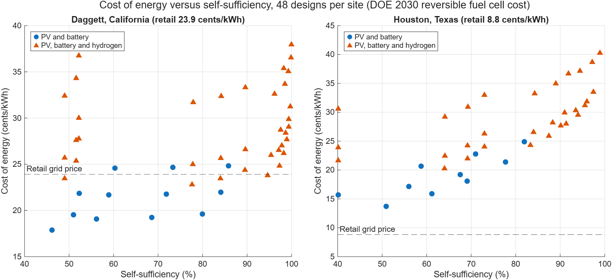
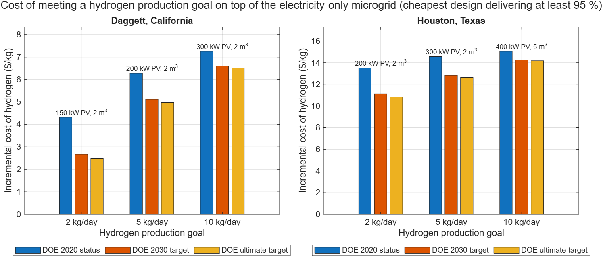
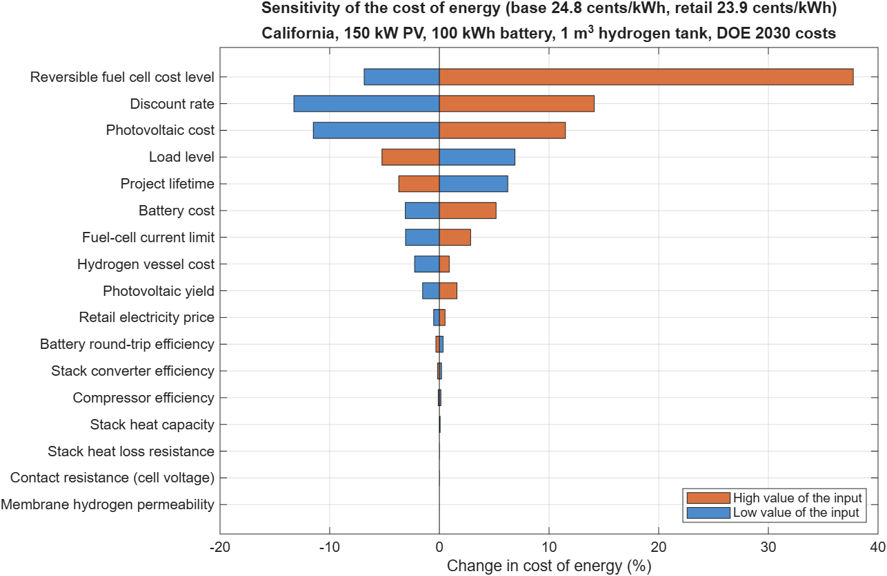

# Guide pédagogique — Partie 3 : résultats, validation, limites et conclusion

Cette partie explique comment lire chaque figure et chaque tableau, ce qu'on peut en conclure, et ce qu'on ne peut pas en conclure.

Parties : [1 — Fondements](guide_1_fondements.md) · [2 — Construction](guide_2_construction.md) · **3 — Résultats**

---

## 7. Résultats

### 7.1 La courbe de polarisation

**Comment la lire.** L'axe horizontal est la densité de courant : négative à gauche (mode pile), positive à droite (électrolyse). La courbe noire est la tension de cellule. Elle traverse l'axe vertical sans rupture : c'est la preuve visuelle que le modèle est bien réversible.

- Au centre, à courant nul, la tension vaut 1,168 V : la tension réversible.
- La courbe monte très vite près de zéro, puis s'aplatit. Cette marche raide est la surtension d'activation.
- Plus loin, la pente régulière est due à la résistance.
- Les points orange sont les mesures publiées. Le modèle passe dessus.

**Le graphique de droite** donne le rendement. En électrolyse il dépasse 100 % à très faible courant : ce n'est pas une erreur. En dessous de la tension thermoneutre (1,481 V), la cellule absorbe de la chaleur de son environnement, et cette chaleur n'est pas comptée comme une dépense électrique. En mode pile, le rendement baisse quand le courant augmente : 59 % à très faible courant, 53 % à 0,5 A/cm², 48 % à 1 A/cm².

**Ce qu'il faut retenir :** une pile réversible est un très bon électrolyseur et une pile moyenne. Le rendement aller-retour est limité par le mode pile.

### 7.2 La calibration

Trois courbes sont ajustées en même temps : la charge, la décharge à l'oxygène, la décharge à l'air. L'erreur moyenne est de 5,3 mV sur des tensions de l'ordre de 0,5 à 1,6 V, soit moins de 1 %.

La courbe à l'air plonge juste après 2 A/cm². C'est le courant limite : il n'y a plus assez d'oxygène. Ce point d'effondrement est fixé par un seul point de mesure, d'où la limite de validité à 1,8 A/cm² à l'air.

Les valeurs trouvées ont un sens physique, ce qui est rassurant :

| Paramètre | Valeur | Commentaire |
|---|---|---|
| Courant d'échange en électrolyse | 1,0×10⁻⁴ A/cm² | Sept fois plus grand qu'en mode pile : produire de l'oxygène est ici plus facile que le consommer |
| Courant d'échange en mode pile | 1,5×10⁻⁵ A/cm² | |
| Teneur en eau de la membrane en mode pile | 10,1 | Plausible pour une membrane au contact de vapeur (entre 10 et 14) |
| Ordre de réaction de l'oxygène | 0,75 | Proche de 1, comme attendu |
| Résistance de contact | 0,037 Ω·cm² | Du même ordre que la membrane |

### 7.3 Le cycle de stockage

Les quatre graphiques montrent, de haut en bas : le courant imposé, la tension de cellule, la température, la pression du réservoir.

- La pile chauffe de 25 à 80 °C en un peu plus de 6 minutes, grâce à son réchauffeur de 5 kW.
- En électrolyse, la tension est de 1,512 V ; en mode pile, de 0,788 V.
- La température reste collée à sa consigne, même au changement de mode où la chaleur dégagée passe brusquement de presque rien à 9,5 kW.
- La pression du réservoir monte de 30 à 90 bar, puis redescend.

| Rendement (base PCS) | Électrolyse | Pile | Aller-retour |
|---|---|---|---|
| Pile seule | 97,8 % | 53,0 % | 51,9 % |
| Système complet | 91,6 % | 51,7 % | 47,4 % |

**Où partent les 4,5 points entre la pile et le système ?** Sur ce cycle, pour 91,5 kWh absorbés : 5,3 kWh pour comprimer l'hydrogène, 0,9 kWh pour chauffer, 0,9 kWh pour refroidir. La compression domine.

**Un résultat de conception.** Si on met la pile directement à la pression du réservoir, pour se passer de compresseur, le rendement aller-retour tombe à 31,9 %. La fuite d'hydrogène à travers la membrane fine devient énorme. Ce résultat dépend beaucoup de la perméabilité de la membrane, connue à un facteur 3 près : il faut le présenter comme une indication, pas comme une certitude.

### 7.4 Le micro-réseau triphasé

C'est la figure la plus parlante du projet. Elle raconte une histoire en trois actes.

**Acte 1 (0 à 1,5 s) : il fait beau.** Le solaire produit 47 kW, la charge en consomme 20. L'excédent de 26 kW part dans la pile, qui fonctionne en électrolyseur. Au tout début, la pile monte lentement en puissance (elle est limitée à 300 A/s) : c'est la batterie qui absorbe l'excédent en attendant.

**Acte 2 (1,5 à 3,5 s) : un nuage passe.** Le solaire tombe à 10,5 kW. Il manque maintenant 10 kW. La pile réduit son courant, **passe par zéro**, et repart dans l'autre sens : elle devient une pile à combustible. Pendant cette inversion, qui prend environ une seconde, la batterie fournit jusqu'à 28 kW.

**Acte 3 (3,5 à 5 s) : la charge augmente.** Elle passe de 20 à 35 kW. La pile monte à sa limite (1 A/cm², 21,6 kW) et la batterie complète avec 3,9 kW.

Regardez le troisième graphique : la tension de cellule (en orange) passe de 1,47 V à 0,80 V en suivant une courbe continue, sans saut. Et la courbe jaune du premier graphique, l'échange avec le réseau, reste presque à zéro tout du long : 98,7 % de l'énergie consommée a été fournie sans le réseau.

Le dernier graphique montre la tension du bus continu. Elle fait une pointe de 38 V au saut de charge, puis revient à 900 V en 0,2 seconde. C'est le signe que la commande de l'onduleur fonctionne.

### 7.5 Moyenné contre commuté

En haut : le courant d'une phase. La courbe orange (modèle moyenné) est une sinusoïde parfaite. La courbe grise (modèle commuté) est la même sinusoïde, épaissie par une ondulation rapide : c'est le découpage à 10 kHz.

En bas à gauche : le spectre. Le modèle commuté montre deux pics, à 10 et 20 kHz, que le modèle moyenné n'a pas.

| | Moyenné | Commuté |
|---|---|---|
| Courant fondamental | 23,49 A | 23,41 A |
| Distorsion du courant | 0,08 % | 9,3 % |
| Temps de calcul pour 0,6 s | 9,7 s | 127 s |

**Deux conclusions.**

1. Sur ce qui compte pour l'énergie (le 60 Hz), les deux modèles sont d'accord à 0,34 % près. On peut donc utiliser le modèle moyenné, 13 fois plus rapide, pour les scénarios de plusieurs secondes.
2. Le modèle commuté révèle un défaut invisible autrement : la distorsion de 9,3 % est trop élevée pour un raccordement au réseau, qui demande en général de l'ordre de 5 %. Presque toute la distorsion est à la fréquence de découpage (8,9 % autour de 10 kHz, seulement 0,13 % en dessous de 3 kHz). Le coupable est donc le filtre, pas la commande. Il faudrait un filtre plus élaboré, dit LCL.

C'est exactement à cela que servent plusieurs niveaux de fidélité : chacun répond à une question que les autres ne peuvent pas traiter.

### 7.6 Une année de fonctionnement

Installation : 150 kW de solaire, batterie de 100 kWh, réservoir de 5 m³, charge moyenne de 20 kW.

**En haut à gauche : le réservoir sur l'année.** À Daggett (bleu), il se remplit au printemps, reste plein tout l'été, et se vide en hiver. C'est du **stockage saisonnier** : ce qu'une batterie ne sait pas faire. À Houston (orange), il reste presque vide une grande partie de l'année : il n'y a pas assez de soleil pour le remplir.

**En bas à gauche : quatre jours de juin.** Le jour, la pile absorbe l'excédent solaire (courbe jaune positive). La nuit, elle le restitue (courbe jaune négative). La batterie (violet) intervient aux transitions.

| Cas | Autosuffisance | Démarrages de la pile | Chauffage de la pile |
|---|---|---|---|
| Daggett, batterie d'abord, arrêt à froid | 99,0 % | 720 | 0,4 MWh |
| Daggett, pile d'abord | 97,4 % | 224 | 0,1 MWh |
| Daggett, pile maintenue chaude | 98,7 % | 717 | 9,1 MWh |
| Daggett, batterie seule | 71,9 % | — | — |
| Daggett, solaire seul | 58,9 % | — | — |
| Houston, batterie d'abord | 89,3 % | 629 | 0,3 MWh |

**L'autosuffisance** est la part de la consommation couverte sans acheter au réseau.

**Les enseignements :**

- Le solaire seul couvre 59 % ; la batterie ajoute 13 points ; l'hydrogène en ajoute 27 de plus.
- Maintenir la pile chaude en permanence coûte 9,1 MWh par an, contre 0,4 MWh si on la laisse refroidir et qu'on la réchauffe à chaque démarrage. Avec une constante de temps thermique de 30 minutes, la pile est froide après deux heures d'arrêt : il vaut mieux payer le réchauffage.
- « Batterie d'abord » donne la meilleure autosuffisance mais use les deux équipements (341 cycles de batterie, 720 démarrages de pile). « Pile d'abord » ménage la batterie (18 cycles).
- Le rendement de la chaîne hydrogène sur l'année est de 41,6 %, et il faut 46 kWh d'électricité pour produire un kilogramme.

### 7.7 Le dimensionnement et les coûts

**Comment lire la figure.** Chaque point est une installation différente (48 par site). Horizontalement, son autosuffisance ; verticalement, ce que coûte l'électricité qu'elle fournit. Les ronds bleus n'ont pas d'hydrogène, les triangles orange en ont. La ligne pointillée est le prix du réseau. **Un point sous la ligne est rentable.**

**Californie (à gauche).** Les ronds bleus s'arrêtent vers 86 % : sans hydrogène, on ne va pas plus loin. Pour dépasser, il faut les triangles orange, et le coût remonte.

| Autosuffisance exigée | Installation la moins chère | Coût | Comparé au réseau |
|---|---|---|---|
| Aucune | 50 kW de solaire | 17,9 ¢/kWh | 0,75 |
| 70 % | 100 kW + batterie 200 kWh | 19,6 ¢/kWh | 0,82 |
| 90 % | 150 kW + hydrogène | 23,8 ¢/kWh | 1,00 |
| 95 % | 150 kW + batterie 100 kWh + hydrogène | 24,8 ¢/kWh | 1,04 |
| 99 % | 200 kW + batterie 200 kWh + hydrogène | 29,1 ¢/kWh | 1,22 |

**Texas (à droite).** Tous les points sont au-dessus de la ligne, et de loin. L'électricité y coûte 8,8 ¢/kWh : rien ne peut concurrencer ce prix.

**L'effet de la technologie.** Pour 95 % d'autosuffisance en Californie, le rapport au prix du réseau vaut 1,35 avec les coûts de 2020, 1,04 avec les cibles 2030 du DOE, et 0,97 avec les cibles ultimes. Autrement dit : aujourd'hui c'est trop cher, en 2030 c'est à parité si les cibles sont tenues.

**Comment est calculé le coût.** Chaque équipement est converti en une dépense annuelle (annuité), on ajoute l'entretien et la facture d'électricité, puis on divise par l'énergie consommée dans l'année. Pour la configuration à 95 %, l'investissement est d'environ 379 000 $, dont 267 000 $ (70 %) pour le solaire.

### 7.8 Les objectifs de production d'hydrogène

Ici, on prélève en plus chaque jour une quantité fixe d'hydrogène pour un usage extérieur (un véhicule, un procédé). Le coût affiché est **incrémental** : ce que coûte en plus le fait de produire cet hydrogène, par rapport au micro-réseau qui ne fait que de l'électricité.

| Objectif | Californie | Texas |
|---|---|---|
| 2 kg/jour | 2,67 $/kg | 11,12 $/kg |
| 5 kg/jour | 5,12 $/kg | 12,84 $/kg |
| 10 kg/jour | 6,60 $/kg | 14,27 $/kg |
| 20 kg/jour | non atteint | non atteint |

**Pourquoi le coût monte avec la quantité ?** Les 2 premiers kilogrammes sont produits avec l'excédent solaire, qui serait sinon revendu 4 ¢/kWh. Ils ne demandent aucun équipement en plus. Au-delà, il faut ajouter des panneaux, et on paie tout le coût de l'électricité : 46 kWh par kilogramme.

**Pourquoi 20 kg/jour n'est pas atteint ?** La pile de 100 cellules ne peut pas produire assez pendant les heures de soleil. Il faudrait une pile plus grande, ce qui n'a pas été étudié.

**Réserve.** Au Texas, les configurations retenues améliorent aussi l'alimentation électrique (93 à 97 % d'autosuffisance contre 88 % pour la référence). Ce gain est compté dans le coût de l'hydrogène, qui est donc surestimé.

### 7.9 La sensibilité

Ce graphique « en tornade » répond à la question : **si je me suis trompé sur une donnée, de combien le résultat change-t-il ?** Chaque barre montre l'effet d'une donnée, quand on la fait varier seule dans une plage raisonnable. Les barres sont classées de la plus influente à la moins influente.

- **En haut, les données qui comptent :** le niveau de coût de la pile (jusqu'à +38 %), le taux d'actualisation (±14 %), le coût du solaire (±11 %).
- **En bas, celles qui ne comptent presque pas :** tous les paramètres physiques estimés sans mesure (capacité et pertes thermiques, perméabilité, rendements des convertisseurs) changent le résultat de moins de 0,4 %.

**C'est l'argument le plus important pour la défense.** On peut vous reprocher d'avoir estimé certains paramètres sans les mesurer. La réponse est : oui, et la sensibilité montre que cela ne change pas les conclusions. Les conclusions dépendent des coûts et des conditions de financement, qui viennent de sources publiques.

---

## 8. Validation

### 8.1 Trois niveaux de preuve, à ne pas confondre

| Niveau | Question | Ce qui a été fait |
|---|---|---|
| **Vérification** | Le code calcule-t-il bien les équations ? | 58 tests ; accord Simscape/MATLAB à 1 µV ; bilans fermés |
| **Comparaison** | Le modèle est-il d'accord avec d'autres modèles ou des données publiées ? | NASA, DOE, article de Berkeley, exemples MathWorks, niveaux de fidélité entre eux |
| **Validation expérimentale** | Le modèle prédit-il une vraie machine ? | **Non réalisée** : aucun banc d'essai |

Soyez clair là-dessus devant les examinateurs. Dire « validé » sans nuance serait faux ; dire « vérifié et comparé à des données publiées » est exact.

### 8.2 Le tableau des preuves

| Contrôle | Résultat | Ce que cela prouve |
|---|---|---|
| Composant Simscape contre fonction MATLAB | 1 µV d'écart | Les deux implémentations sont identiques |
| Tension réversible contre la NASA | 0,25 et 0,55 mV | La thermodynamique est juste, sans ajustement |
| Rapport des tensions contre l'état de l'art du DOE | 52,1 % contre 52 % | Le modèle calibré est représentatif (valeur non utilisée pour ajuster) |
| Validation croisée de la calibration | 7,3 mV | Le modèle prédit bien entre les points de mesure |
| Numérisation contre les valeurs écrites dans l'article | 56,2 / 52,5 / 44,6 % lus, 56,4 / 52,3 / 45 % écrits | Les points extraits de la figure sont justes |
| Comparaison aux exemples MathWorks | 42 à 44 mV | Mêmes formes de courbes ; l'écart est expliqué |
| Bilans du modèle de stockage | Fermés à mieux que 0,001 % | Rien ne se crée ni ne se perd |
| Moyenné contre commuté | 0,34 % sur le fondamental | Le modèle rapide est fiable pour l'énergie |
| Annuel contre Simscape sur une journée | 0,001 % sur l'énergie, 0,6 % sur l'hydrogène | Le modèle annuel est fidèle au modèle détaillé |
| Fermeture de l'irradiance | 18 W/m² | Les données météo et le calcul solaire sont cohérents |

### 8.3 L'écart avec les exemples MathWorks, expliqué

Notre modèle donne des tensions environ 40 mV plus basses que les exemples MathWorks. Ce n'est pas une erreur : notre tension réversible baisse avec la température (0,85 mV par kelvin, soit 47 mV à 80 °C), alors que MathWorks la garde fixe à 1,229 V. Notre choix est le plus rigoureux, et c'est celui que confirme la NASA.

### 8.4 L'écart de 0,6 % sur l'hydrogène, expliqué

Le modèle détaillé consomme 0,6 % d'hydrogène de plus que le modèle annuel sur une journée. La cause est identifiée et calculée : pendant les 14 heures d'arrêt, la pile maintenue sous pression laisse fuir un peu d'hydrogène à travers la membrane, soit 13 mol. Le modèle annuel néglige cette fuite à l'arrêt.

### 8.5 Ce que disent les tests

Les tests ne prouvent pas que le modèle représente la réalité. Ils prouvent que le code fait ce qu'il prétend faire, et ils protègent contre les régressions : si une modification casse quelque chose, un test échoue. Par exemple, un test vérifie que les données de coût sont bien celles des sources, pour qu'une faute de frappe ne passe pas inaperçue.

---

## 9. Limites et perspectives

### 9.1 Les limites, par ordre d'importance

**1. Pas de validation expérimentale.** C'est la limite principale. Le modèle est calibré sur une seule cellule publiée, à une seule température (80 °C) et à pression ambiante.

- L'effet de la température sur la cinétique n'est pas identifié. Le modèle n'est fiable qu'autour de 80 °C.
- Le fonctionnement sous pression est une extrapolation.
- Les conditions exactes de la mesure publiée (pression, humidité) ne sont pas données dans l'article ; elles ont été supposées.

**2. Le vieillissement n'est pas modélisé.** 720 démarrages par an useraient la pile plus vite que ne le dit la durée de vie en heures. Le modèle l'ignore, ce qui avantage la stratégie « batterie d'abord ».

**3. Les données de coût sont hétérogènes.** Elles viennent de sources d'années et d'échelles différentes. Le coût de batterie est celui d'une grande installation ; le coût de réservoir date de 2012 ; aucune aide publique ni tarif horaire n'est compté.

**4. Le dimensionnement n'est pas un vrai optimum.** La meilleure configuration retient toujours le plus petit réservoir de la grille, et la taille de la pile n'a pas été variée.

**5. Des paramètres physiques sont estimés** : thermique de la pile, rendements des convertisseurs et du compresseur. La sensibilité montre que cela pèse peu.

**6. Le micro-réseau est simplifié.** Réseau idéal, interrupteurs idéaux, seul l'onduleur est commuté, pas de fonctionnement en îlotage.

**7. Une seule année météo**, issue de données satellitaires et non de mesures au sol, et un profil de charge inventé.

### 9.2 Les perspectives

- Mesurer une vraie cellule à plusieurs températures et pressions, pour calibrer l'effet de la température.
- Ajouter un filtre LCL et l'impédance du réseau, puis étudier la qualité du courant et l'îlotage.
- Modéliser le vieillissement en fonction des heures et des démarrages.
- Remplacer les règles de gestion par une commande optimisée, et mesurer le gain.
- Optimiser la taille de la pile, affiner la grille, utiliser plusieurs années météo, intégrer les tarifs et les aides.

---

## 10. Conclusion

### 10.1 La démarche en cinq étapes

1. **Comprendre** : lire l'énoncé, les exemples MathWorks et la soumission existante, et repérer le verrou (aucun composant n'est réversible).
2. **Modéliser** : écrire une cellule réversible avec un seul jeu d'équations, grâce au sinus hyperbolique inverse.
3. **Calibrer** : chercher des données, constater que les premières ne suffisent pas, en numériser de meilleures, comparer plusieurs jeux de paramètres.
4. **Intégrer** : construire le stockage, puis le micro-réseau triphasé à deux niveaux de fidélité, puis le modèle annuel, en vérifiant chaque niveau contre le précédent.
5. **Exploiter** : dimensionner, chiffrer, tester la sensibilité, et en tirer des recommandations.

### 10.2 Les contributions

1. Un composant Simscape de pile PEM réversible unique, continu au passage par zéro.
2. Une calibration sur une cellule publiée dans trois conditions, avec numérisation vérifiée et validation croisée.
3. Un micro-réseau triphasé à deux niveaux de fidélité électrique, vérifiés l'un contre l'autre.
4. Un modèle annuel qui réutilise les mêmes équations et simule une année en quelques secondes.
5. Une évaluation économique sourcée pour deux sites et trois niveaux de coût.
6. Cinquante-six tests automatiques et des modèles générés par script.

### 10.3 La réponse à la problématique

**Peut-on produire de l'hydrogène vert de façon économique et régulière avec une source solaire variable, tout en fournissant de l'électricité ?**

- **Techniquement, oui.** Une pile réversible associée à une batterie permet de couvrir 95 à 99 % de la consommation avec du solaire, là où la batterie seule plafonne à 86 %. La pile assure le stockage long, la batterie les variations rapides.
- **Économiquement, cela dépend de deux choses.** Du prix local de l'électricité d'abord : la même installation est à parité avec le réseau en Californie et trois fois trop chère au Texas. Du coût de la pile ensuite : aux coûts de 2020 l'opération n'est pas rentable, aux cibles 2030 du DOE elle l'est en Californie.
- **Pour l'hydrogène lui-même**, les premiers kilogrammes produits avec l'excédent solaire reviennent à environ 2,7 $/kg en Californie ; au-delà, le coût double.

### 10.4 Trois phrases à retenir

1. « Un seul composant, un seul jeu d'équations, trois échelles de temps. »
2. « L'hydrogène n'est pas un concurrent de la batterie : il prend le relais là où elle s'arrête, vers 86 % d'autosuffisance. »
3. « Les conclusions dépendent du coût de la pile et du prix local de l'électricité, pas des paramètres physiques que nous avons dû estimer. »
