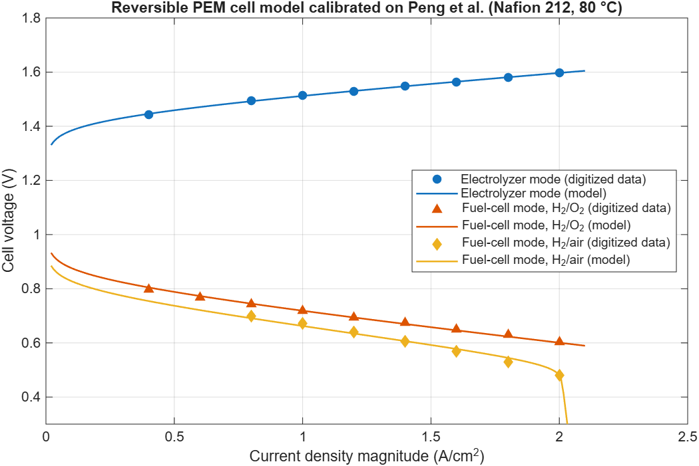
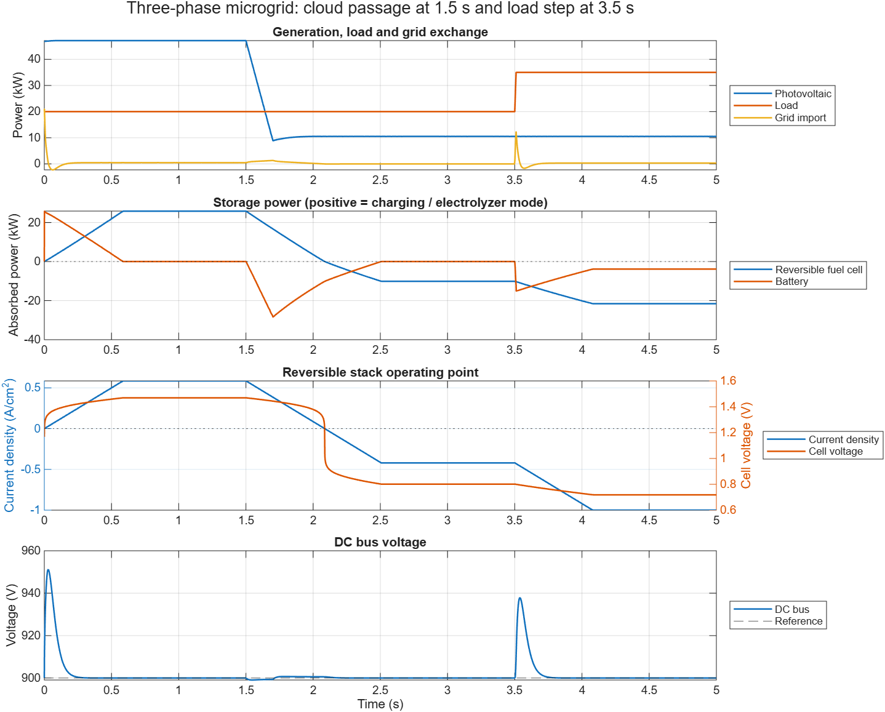
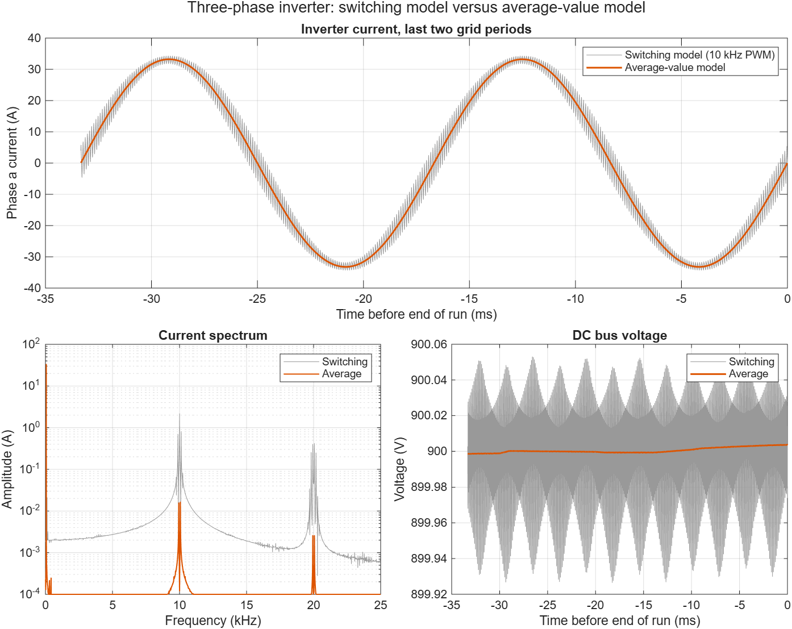
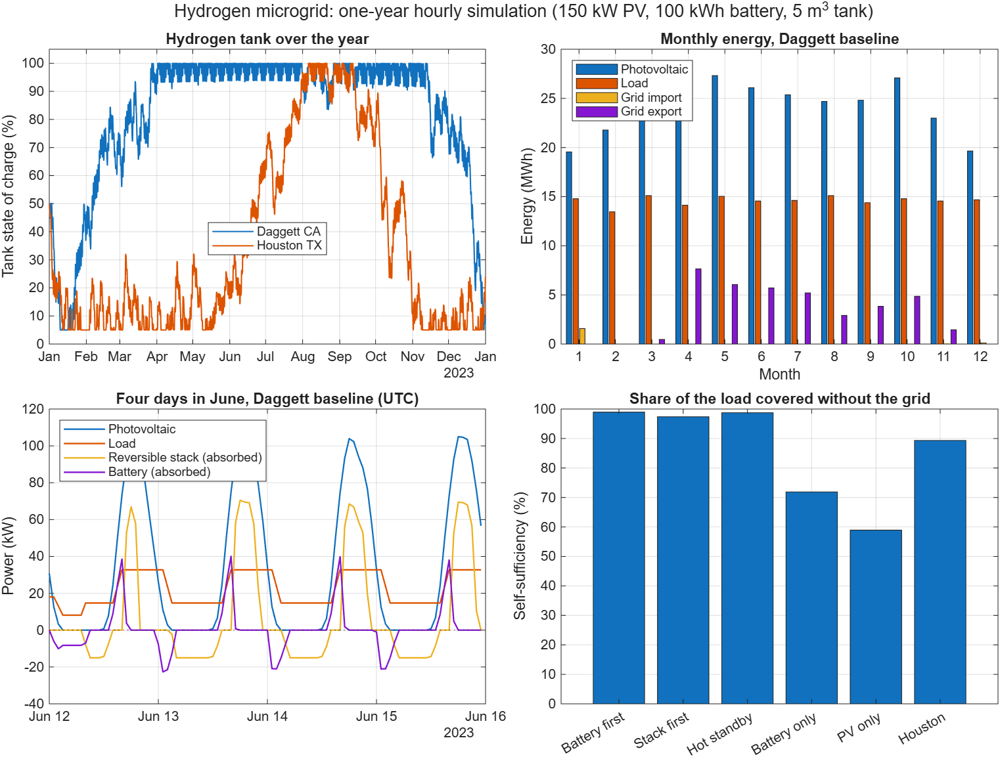
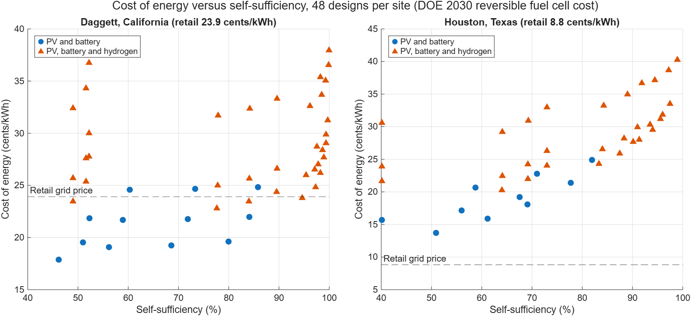
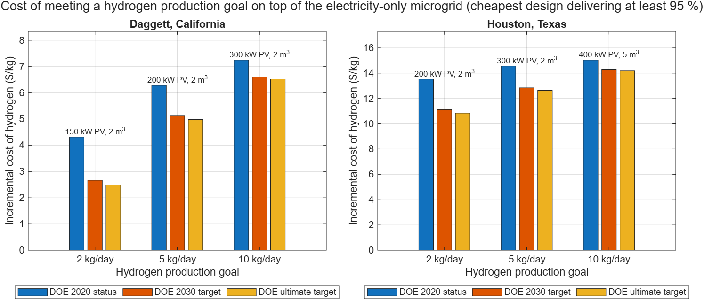
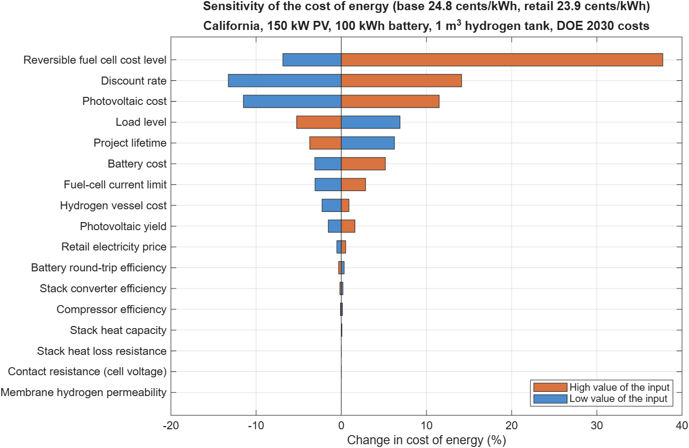

# Green Hydrogen Production: a Reversible PEM Fuel Cell in a Three-Phase Renewable Microgrid

Technical report for MathWorks Challenge Project 204

Author: Amani Charles DETONGNON

## 1. Problem statement and objectives

Green hydrogen is produced by water electrolysis powered by renewable electricity. Its production must become economical and repeatable although the renewable source is variable and the installation must also supply electricity.

The challenge project asks for:

1. a reversible fuel cell model written in the Simscape language, able to act as an electricity generator or as an electrolyzer;
2. its integration in a three-phase renewable microgrid with solar power and energy storage;
3. models of different fidelity levels, from power-electronic switching to system response over days or weeks, including thermal response;
4. efficiency and power requirements for several operational scenarios;
5. data-driven recommendations for industry and for government.

This report answers the five points. The technology studied is the unitized regenerative PEM fuel cell (URFC), in which one stack performs both functions. The sites studied are in the United States.

## 2. Scientific and technical background

A PEM cell combines hydrogen and oxygen into water and delivers electricity (fuel-cell mode), or uses electricity to split water (electrolyzer mode):

```math
\mathrm{H_2 + \tfrac{1}{2}O_2 \rightleftharpoons H_2O}
```

Two voltages characterize the reaction with liquid water at 25 °C. The reversible voltage, $E^0 = -\Delta G/(2F) = 1.229$ V, is the cell voltage at equilibrium. The thermoneutral voltage, $V_{tn} = -\Delta H/(2F) = 1.481$ V, corresponds to the higher heating value of hydrogen (285.8 kJ/mol). An electrolyzer operating above $V_{tn}$ releases heat; a fuel cell always does.

A real cell departs from the reversible voltage because of three losses: the activation of the electrode reactions (dominated by the oxygen electrode), the ohmic resistance of the membrane and contacts, and the limited transport of reactants. In electrolyzer mode the losses raise the voltage, in fuel-cell mode they lower it. The round-trip efficiency of a storage cycle is therefore well below one. The United States Department of Energy (DOE) reports a status of 52 % for the ratio of the fuel-cell voltage at 0.5 A/cm² to the electrolyzer voltage at 1 A/cm², with targets of 55 % for 2030 and 65 % ultimately [2].

Existing material was reviewed before modeling:

- The MathWorks examples *PEM Fuel Cell System* and *PEM Electrolysis System* contain two Simscape components with nearly identical physics, each of which forces the current density to zero when the current has the sign of the other mode.
- The earlier submission to this project [8] uses two separate components for the two modes in a DC microgrid, at fixed temperature. Its hydrogen flow equation omits the factor two of Faraday's law (two electrons per hydrogen molecule).
- No reversible component is available in the installed libraries. A single reversible component is therefore the core contribution of this work.

## 3. Methodology and mathematical formulation

### 3.1 Reversible cell

Sign convention: the current density $j$ is positive in electrolyzer mode and negative in fuel-cell mode. The cell voltage is

```math
V = V_{rev} + \eta_{act} + \eta_{ohm} + \eta_{conc}
```

where every overpotential has the sign of $j$.

**Reversible voltage (Nernst, liquid water):**

```math
V_{rev} = 1.229 - 8.5\times10^{-4}\,(T - 298.15) + \frac{RT}{2F}\ln\!\left(p_{H_2}\,p_{O_2}^{1/2}\right)
```

with pressures in bar.

**Activation overpotential.** The symmetric Butler-Volmer equation is inverted in closed form:

```math
\eta_{act} = \frac{RT}{2\alpha F}\,\mathrm{asinh}\!\left(\frac{j}{2 j_0}\right)
```

This expression is zero at $j = 0$, odd in $j$, and tends to the Tafel law $\frac{RT}{2\alpha F}\ln(|j|/j_0)$ for $|j| \gg j_0$. It removes the discontinuity that prevents the two MathWorks components from being merged. The exchange current density and transfer coefficient take different values in the two modes, because the oxygen electrode does not behave symmetrically. In fuel-cell mode the exchange current density depends on the oxygen partial pressure:

```math
j_0 = j_{0,FC}\,p_{O_2}^{\gamma}\,\exp\!\left[-\frac{E_a}{R}\left(\frac{1}{T}-\frac{1}{T_{ref}}\right)\right]
```

**Ohmic overpotential.** The membrane conductivity follows the Springer correlation, with a water content $\lambda$ that depends on the mode (liquid-equilibrated in electrolyzer mode, vapor-equilibrated in fuel-cell mode):

```math
\sigma = (0.005139\,\lambda - 0.00326)\,\exp\!\left[1268\left(\frac{1}{303}-\frac{1}{T}\right)\right],\qquad \eta_{ohm} = \left(\frac{t_m}{\sigma} + R_c\right) j
```

Because $\eta_{ohm}$ is proportional to $j$, switching $\lambda$ at $j = 0$ does not create a voltage jump.

**Concentration overpotential:**

```math
\eta_{conc} = -\mathrm{sign}(j)\,\frac{RT}{2F}\ln\!\left(1 - \frac{|j|}{j_L}\right)
```

linearized beyond 99.9 % of the limiting current for numerical robustness. In fuel-cell mode $j_L$ is proportional to the oxygen partial pressure.

**Hydrogen flow and crossover.** Faraday's law gives the hydrogen produced or consumed; permeation through the membrane, proportional to the hydrogen pressure and inversely proportional to the membrane thickness, is subtracted:

```math
\dot n_{H_2} = \frac{N A\,(j - j_x)}{2F},\qquad j_x = \frac{2F\,\psi\,p_{H_2}}{t_m}
```

Crossover lowers production in electrolyzer mode and raises consumption in fuel-cell mode.

**Heat.** The waste heat is the electrical power minus the chemical power stored on a higher-heating-value basis, $\dot Q = VI - \dot n_{H_2}\ \Delta H$. It is sent to a thermal port, so the energy balance closes by construction.

### 3.2 Storage subsystem

The stack is connected to a lumped thermal mass $C\ \dot T = \dot Q + \dot Q_{tm} - (T - T_{amb})/R_{th}$, where $\dot Q_{tm}$ is the heating or cooling power set by a PI controller with output limits and anti-windup. The tank is a fixed-volume isothermal vessel with the Abel-Noble equation of state

```math
p\,(V - n b) = nRT
```

Two architectures are available: a stack at ambient pressure with a mechanical compressor (intercooled multi-stage, default), or a stack at tank pressure.

### 3.3 Three-phase microgrid

A 900 V DC bus with a grounded midpoint couples three devices through average-value DC-DC converters written in the Simscape language: a photovoltaic array (voltage-controlled, perturb-and-observe MPPT), a battery and the reversible stack (both current-controlled). Each converter conserves power with a constant efficiency. A three-phase voltage source converter connects the bus to a 480 V, 60 Hz grid through an R-L filter, with a three-phase load at the point of common coupling.

The inverter controller is grid-following: a synchronous-reference-frame phase-locked loop, an outer PI loop on the DC voltage that sets the d-axis current reference, and inner PI current loops with decoupling and grid-voltage feedforward. The controllers are discrete (100 µs) with a one-sample computation delay.

The energy management system is rule-based. It computes the net power on the DC bus, makes the stack follow it (electrolyzer on surplus, fuel cell on deficit) within current limits, a dead band, a slew-rate limit and the tank state of charge, lets the battery cover the remainder, and leaves what neither can cover to the grid.

### 3.4 Fidelity levels

| Level | Inverter | Step | Purpose |
|---|---|---|---|
| Switching | two-level converter, ideal switches, 10 kHz sinusoidal PWM | 2.5 µs | ripple and harmonics |
| Average-value | average converter driven by modulation signals | 100 µs | control and power sharing over seconds |
| Quasi-static | hourly power balance, stack tabulated from the cell equations | 1 h | one year of operation, sizing and cost |

The three levels use the same cell equations and parameters. The annual model adds converter efficiencies, compression work, and the heating energy of the stack: when idle the stack either cools down and is reheated at the next start, or is kept at temperature by its heater.

### 3.5 Economics

Each investment is converted to an annual payment with the capital recovery factor $r(1+r)^n/((1+r)^n-1)$ over its own lifetime; fixed operation and maintenance and the net grid bill are added. The stack lifetime is the durability in hours divided by the simulated operating hours per year. The cost of energy is the total annual cost divided by the load energy and is compared with the retail electricity price.

### 3.6 Alternatives considered

- *Cell model.* An empirical polarization curve would be simpler but has no physical basis for pressure, temperature or oxidant changes. A distributed model with gas channels and water transport, as in the MathWorks examples, is more detailed but cannot be validated without measurements and is too slow for long simulations. The lumped semi-empirical model retained here is the most detailed one that the available data can calibrate.
- *Energy management.* Model predictive control and optimization-based dispatch were considered. A rule-based strategy was retained because it is transparent, needs no forecast, and two variants (battery first, stack first) already bracket the main trade-off.
- *Calibration data.* Fitting only tabulated values from a NASA report gives an exact fit with no degree of freedom and parameters that are not representative of a modern cell. Digitizing full curves from a recent paper gives a genuine least-squares problem.

## 4. MATLAB and Simulink implementation

The project is organized in packages (`+urfc`, `+h2`, `+microgrid`, `+solar`, `+longterm`, `+econ`), a Simscape library (`simscape/+greenH2`), model-building scripts (`models`), analysis and validation scripts, and tests.

- **Simscape language.** Four components: `ReversibleFuelCell`, `HydrogenTank`, `DcDcCurrentControlled`, `DcDcVoltageControlled`. They are compiled into `greenH2_lib` by `setupProject`.
- **Reference implementation.** `urfc.cellModel` implements the cell equations in MATLAB. It is used for calibration and for the annual model, and a test verifies that the Simscape component gives the same voltage.
- **Models generated by scripts.** `buildUrfcStorageSystem` and `buildMicrogridAverage` create the Simulink models programmatically, so that every block, parameter and connection is traceable and the switching and average variants differ only in the inverter.
- **Controllers as testable functions.** `inverterControlStep`, `mpptStep` and `emsStep` are plain functions with explicit state, called from discrete MATLAB Function blocks and tested on their own.
- **Calibration.** `urfc.calibrate` uses `lsqnonlin` and reports degrees of freedom, the conditioning of the Jacobian and parameter correlations.

Toolboxes: Simulink, Simscape, Simscape Electrical, Optimization Toolbox; Image Processing Toolbox for the digitization only.

## 5. Simulation procedures

| Script | Content | Duration |
|---|---|---|
| `main` | setup, polarization, storage cycle, microgrid demonstration, annual simulation | about 5 min |
| `main("full")` | adds inverter fidelity comparison, sizing, hydrogen goals, sensitivity | about 15 min more |
| `runAllTests` | 58 tests | about 7 min |

Weather data are hourly NASA POWER data for 2023 at Daggett, California and Houston, Texas (satellite-derived irradiance, reanalysis meteorology). The load is a synthetic small-commercial profile with a mean of 20 kW. Irradiance on the tilted array is computed with a solar position algorithm and an isotropic sky model, and the array power with a cell-temperature correction.

## 6. Results and performance evaluation

### 6.1 Cell calibration

Polarization curves of a unitized cell (Nafion 212, 80 °C, no iR correction) were digitized from Fig. 2a of [3]: electrolyzer mode, fuel-cell mode with oxygen and with air, 24 points from 0.4 to 2 A/cm². Six parameters were fitted.

| Parameter | Value | Status |
|---|---|---|
| Exchange current density, electrolyzer mode | 1.01×10⁻⁴ A/cm² | fitted |
| Exchange current density, fuel-cell mode (1 bar O₂) | 1.48×10⁻⁵ A/cm² | fitted |
| Contact resistance | 0.0374 Ω·cm² | fitted |
| Membrane water content, fuel-cell mode | 10.1 | fitted |
| Oxygen reaction order | 0.75 | fitted |
| Limiting current density, fuel-cell mode (1 bar O₂) | 17.8 A/cm² | fitted |
| Transfer coefficients | 0.5 | assumed |
| Membrane water content, electrolyzer mode | 22 | assumed |

Fit quality: RMSE 5.3 mV, maximum error 15 mV. Candidate parameter sets were compared by leave-one-out cross-validation; the retained set has an error of 7.3 mV on interior points.



At 1 A/cm² the model gives 1.512 V in electrolyzer mode and 0.719 V in fuel-cell mode.

### 6.2 Storage subsystem

A stack of 100 cells of 300 cm² was simulated over a warm-up, two hours of electrolysis at 1 A/cm² and three hours of generation at 0.5 A/cm².

| Efficiency (HHV) | Electrolyzer | Fuel cell | Round trip |
|---|---|---|---|
| Stack | 97.8 % | 53.0 % | 51.9 % |
| System | 91.6 % | 51.7 % | 47.4 % |

The system figures include mechanical compression, heating and cooling. The stack reaches its operating temperature in about six minutes and stays within 2 K of the setpoint.

Operating the stack directly at tank pressure lowers the system round-trip efficiency to 31.9 %, because crossover through the thin membrane grows with pressure. This result depends strongly on the membrane permeability, which is only known within a factor of about three.

### 6.3 Three-phase microgrid

Scenario: irradiance falls from 800 to 200 W/m² at 1.5 s, the load steps from 20 to 35 kW at 3.5 s.



| Time | PV | Load | Stack | Battery | Grid |
|---|---|---|---|---|---|
| 1.4 s | 47.1 kW | 20 kW | +25.8 kW (electrolyzer, 0.59 A/cm²) | 0 | 0.5 kW |
| 2.9 s | 10.5 kW | 20 kW | −10.1 kW (fuel cell, 0.42 A/cm²) | 0 | ≈ 0 |
| 4.9 s | 10.5 kW | 35 kW | −21.6 kW (fuel cell, 1.0 A/cm²) | −3.9 kW | 0.3 kW |

The stack changes mode through zero current with a continuous voltage. The battery supplies up to 28 kW while the stack, limited to 300 A/s, changes regime. The DC bus deviates by at most 38 V and 98.7 % of the load energy is supplied without the grid.

### 6.4 Switching versus average-value inverter



| | Average | Switching |
|---|---|---|
| Fundamental current (RMS) | 23.49 A | 23.41 A |
| Inverter power | 19.53 kW | 19.46 kW |
| Current THD | 0.08 % | 9.3 % |
| DC bus ripple (peak to peak) | 0.006 V | 0.13 V |
| Computation time for 0.6 s | 9.7 s | 127 s |

The average model reproduces the fundamental behavior within 0.35 % and is 13 times faster. The distortion of 9.3 % comes almost entirely from the switching frequency (8.9 % around 10 kHz, 2.4 % around 20 kHz, 0.13 % below 3 kHz): the 2 mH inductive filter is insufficient and an LCL filter would be required for grid connection.

### 6.5 One year of operation

System: 150 kW photovoltaics, 100 kWh battery, 100-cell stack, 5 m³ tank, 20 kW mean load.



| Case | Self-sufficiency | Grid import | Stack starts | Stack heating |
|---|---|---|---|---|
| Daggett, battery first, cold standby | 99.0 % | 1.8 MWh | 720 | 0.4 MWh |
| Daggett, stack first | 97.4 % | 4.6 MWh | 224 | 0.1 MWh |
| Daggett, hot standby | 98.7 % | 2.2 MWh | 717 | 9.1 MWh |
| Daggett, battery only | 71.9 % | 49.3 MWh | – | – |
| Daggett, photovoltaics only | 58.9 % | 72.0 MWh | – | – |
| Houston, battery first, cold standby | 89.3 % | 18.7 MWh | 629 | 0.3 MWh |

The hydrogen path delivers 41.6 % of the electricity it absorbs, and electrolysis uses about 46 kWh per kilogram at system level. The annual photovoltaic yield is 1945 kWh/kWp at Daggett and 1484 kWh/kWp at Houston. In this table the tank starts half full and is not required to return to that level; the sizing study below uses a periodic year.

### 6.6 Sizing and cost of energy

Forty-eight designs per site were simulated over a periodic year and costed with three reversible-fuel-cell cost levels.



Cheapest design in California (retail price 23.9 cents/kWh), DOE 2030 cost level:

| Required self-sufficiency | Design | Cost of energy | Ratio to retail |
|---|---|---|---|
| none | 50 kW PV | 17.9 cents/kWh | 0.75 |
| 70 % | 100 kW PV, 200 kWh battery | 19.6 | 0.82 |
| 90 % | 150 kW PV, hydrogen, no battery | 23.8 | 1.00 |
| 95 % | 150 kW PV, 100 kWh battery, hydrogen | 24.8 | 1.04 |
| 99 % | 200 kW PV, 200 kWh battery, hydrogen | 29.1 | 1.22 |

For 95 % self-sufficiency the ratio to the retail price is 1.35 at the 2020 cost status, 1.04 at the 2030 target and 0.97 at the ultimate target. Without hydrogen, self-sufficiency does not exceed 86 % in California and 82 % in Texas over the designs studied. In Texas (8.8 cents/kWh) photovoltaics alone already cost 1.21 times the retail price and 90 % self-sufficiency more than three times.

### 6.7 Hydrogen production goals

A constant hydrogen offtake was added. The cost reported is incremental: the additional annual cost over the electricity-only reference system divided by the hydrogen delivered.



| Goal | California, 2030 costs | Texas, 2030 costs |
|---|---|---|
| 2 kg/day | 2.67 $/kg (150 kW PV) | 11.12 $/kg (200 kW PV) |
| 5 kg/day | 5.12 $/kg (200 kW PV) | 12.84 $/kg (300 kW PV) |
| 10 kg/day | 6.60 $/kg (300 kW PV) | 14.27 $/kg (400 kW PV) |
| 20 kg/day | not reached (90 % at best) | not reached (78 % at best) |

The first kilograms are the cheapest because they use surplus solar energy that would otherwise be exported at a low price. Larger goals require additional photovoltaic capacity. The Texas figures also pay for a higher electrical self-sufficiency than the reference, so they overstate the cost of hydrogen alone.

### 6.8 Sensitivity



Seventeen inputs were varied one at a time on the 95 % design in California. The cost of energy is most sensitive to the reversible-fuel-cell cost level (−7 % to +38 %), the discount rate (−13 % to +14 %) and the photovoltaic cost (±11 %). Every uncalibrated physical estimate (stack heat capacity and heat loss, membrane permeability, converter and compressor efficiencies, contact resistance) changes it by less than 0.4 %.

## 7. Validation

| Check | Result |
|---|---|
| Simscape component against MATLAB reference | within 1 µV over both modes |
| Reversible voltage against NASA theoretical potentials [1] | 0.25 mV and 0.55 mV |
| Voltage ratio at the DOE definition against the DOE 2020 status [2] | 52.1 % against 52 % (not used in the fit) |
| Calibration, leave-one-out cross-validation | 7.3 mV on interior points |
| Digitization against values printed in the source paper | efficiencies 56.2 / 52.5 / 44.6 % read, 56.4 / 52.3 / 45 % printed; current positions within 2 mA/cm² |
| Comparison with MathWorks PEM examples | RMSE 44 mV (electrolyzer) and 42 mV (fuel cell); the offset is explained mainly by the temperature dependence of the reversible voltage |
| Hydrogen, stack-energy and thermal balances of the storage model | closed to 3×10⁻⁵ mol, numerical precision and 8×10⁻⁶ relative |
| Average-value against switching inverter | fundamental current within 0.34 % |
| Annual model against Simscape storage model over one day | stack energies within 0.001 %, hydrogen consumed within 0.6 % |
| Irradiance closure of the weather data | 18 W/m² RMSE with the sun at mid-hour |
| Automated tests | 58 tests |

These checks verify the implementation and compare the model with published data and with other models. They are not an experimental validation on hardware.

## 8. Contributions

1. A single reversible PEM cell component in the Simscape language, with a voltage that is continuous through zero current, mode-dependent kinetics and membrane hydration, pressure-dependent crossover and a thermal port.
2. A calibration on a published unitized cell in three operating conditions, with an automated digitization checked against the values printed in the paper, cross-validation and an identifiability analysis.
3. A three-phase microgrid at two electrical fidelity levels, with the average-value model verified against the switching model.
4. A third, quasi-static level that reuses the same cell equations and is cross-checked against the Simscape model, enabling annual simulation, sizing and cost studies in seconds.
5. A techno-economic assessment with sourced cost data, for two sites and three technology cost levels, with a sensitivity analysis.
6. Fifty-six automated tests and script-generated models, so that every result can be reproduced with one command.

## 9. Recommendations

### For industry

- **Develop reversible stacks for long-duration storage, not for daily cycling.** Batteries are cheaper up to about 80 to 86 % self-sufficiency; the reversible stack is what makes higher levels possible.
- **Prioritize cost and lifetime over efficiency.** Moving from the 2020 status to the 2030 target reduces the cost of energy of the 95 % design by about a quarter, through capital cost and durability; the sensitivity to efficiency-related parameters is below 1 %.
- **Let the stack cool down when idle.** Hot standby costs more than twenty times the heating energy of cold standby in the case studied (9.1 MWh against 0.4 MWh per year).
- **Operate thin-membrane reversible stacks at low pressure and compress mechanically**, unless the membrane permeability is shown to be at the low end of its range.
- **Pair the stack with a battery.** The battery covers fast transients and short cycles, which reduces stack starts.

### For government

- **Target support where retail electricity is expensive.** The same system reaches parity with the grid in California at 2030 costs and costs three times the grid price in Texas.
- **Fund cost and durability targets.** Meeting the DOE 2030 targets is sufficient for 95 % self-sufficiency at the retail price in California; the 2020 status is not.
- **Reduce the cost of capital.** A change of two points in the discount rate changes the cost of energy by about 14 %, as much as a 25 % change in photovoltaic cost.
- **Value small hydrogen offtakes from surplus energy.** The first kilograms per day cost about 2.7 $/kg in California because they use energy that would otherwise be exported at a low price.

These recommendations hold within the assumptions of the study, listed below.

## 10. Limitations

- No experimental validation. The cell is calibrated on one published cell at 80 °C and ambient pressure; the temperature dependence of the kinetics is not identified, and operation at other pressures is an extrapolation.
- The limiting current with air is fixed by a single data point; the model is valid up to 1.8 A/cm² with air.
- Operating pressure and humidification of the source measurements are not stated in the source and were assumed.
- Thermal parameters of the stack, converter efficiencies, compressor efficiency and cooling parasitics are engineering estimates. The sensitivity analysis shows that they have little effect on the economic results.
- Degradation and the effect of the number of starts on lifetime are not modeled.
- The switching model uses ideal switches without dead time or switching losses, and only the inverter is switched. The grid is ideal.
- The load profile is synthetic. One weather year is used, from gridded satellite and reanalysis data.
- Cost data come from sources with different dollar years and scales (the battery cost is a utility-scale figure, the vessel cost dates from 2012); no incentive or time-of-use tariff is included. The stack cost per kilowatt was read from a table whose text extraction was imperfect and should be checked against the original document.
- In the sizing study the optimum lies on the edge of the design grid for the tank volume, and the stack size is not optimized.
- The hydrogen cost is incremental, at the tank outlet, without distribution or dispensing.

## 11. Future work

- Validate the cell model against measurements at several temperatures and pressures.
- Add an LCL filter and grid impedance, and study power quality and islanded operation.
- Model degradation as a function of operating hours and starts.
- Replace the rule-based energy management with an optimization-based or predictive strategy and quantify the gain.
- Optimize the stack size and refine the design grid; include several weather years, tariffs and incentives.

## 12. Use of generative AI

The project was developed with substantial assistance from Claude (Anthropic), used as an agent through Claude Code with the MATLAB MCP server. The agent drafted code, models, tests and documentation and executed them in a live MATLAB session, under the direction of the author, who made the main choices and validated each stage. All AI-generated code was executed and tested. No data were generated by the AI: measurements, cost data and weather data come from the cited sources, and assumptions without a source are flagged.

## References

1. W. R. Bennett, P. J. Smith, I. J. Jakupca, *Analysis of 100-W Regenerative Fuel Cell Demonstration*, NASA/TM-20205000357, 2020. https://ntrs.nasa.gov/citations/20205000357
2. D. Peterson, *Reversible Fuel Cell Targets*, DOE Hydrogen and Fuel Cells Program Record 20001, 2020. https://www.hydrogen.energy.gov/pdfs/20001-reversible-fuel-cell-targets.pdf
3. X. Peng et al., *Hierarchical Electrode Design of Highly Efficient and Stable Unitized Regenerative Fuel Cells (URFCs) for Long-term Energy Storage*, Lawrence Berkeley National Laboratory, open-access manuscript, eScholarship.
4. NREL, *Annual Technology Baseline 2024*, Commercial PV and Commercial Battery Storage. https://atb.nrel.gov
5. U.S. Energy Information Administration, *Cost and Performance Characteristics of New Generating Technologies, Annual Energy Outlook 2023*; *Electric Power Annual*, Table 2.10.
6. NASA Langley Research Center, *Prediction Of Worldwide Energy Resources (POWER)*, hourly data. https://power.larc.nasa.gov
7. MathWorks, *PEM Fuel Cell System* and *PEM Electrolysis System*, Simscape examples.
8. M. Barbosa, *Modeling and Simulation of a Green Hydrogen Energy Storage DC Microgrid*, 2022. https://github.com/michaelfsb/green-hydrogen-production
9. Oak Ridge National Laboratory, steel/concrete composite vessel for stationary hydrogen storage, 2012.
10. K. Ayers, *A Novel Stack Approach to Enable High Roundtrip Efficiencies in Unitized PEM Regenerative Fuel Cells*, DOE Annual Merit Review, project FC331, 2023.
11. T. E. Springer, T. A. Zawodzinski, S. Gottesfeld, *Polymer Electrolyte Fuel Cell Model*, Journal of The Electrochemical Society, 1991 (membrane conductivity correlation, as used in the MathWorks examples).
12. J. W. Spencer, *Fourier series representation of the position of the sun*, Search, 1971.
